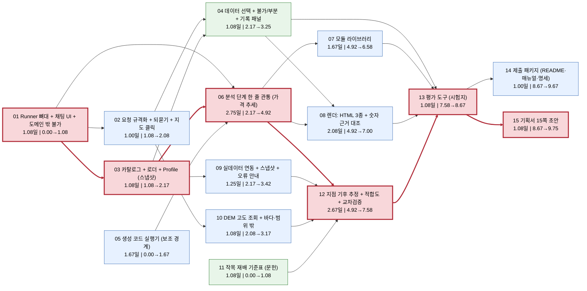

# PERT 차트 — 티켓 의존성과 일정

> **초안.** `to-tickets` 분해안(15개)이 아직 승인 전이라 티켓 번호·의존성은 바뀔 수 있다. 소요일은 **내 추정치**이며 실측으로 검증된 값이 아니다.

## 가정

- 기간: 2026-11-09 시작 → 2026-11-19 사전 제출 (끝까지 **11일**). 마감은 11-20 10:00.
- 단위: 일(하루 = 한 사람이 AI 코딩 보조와 함께 일한 하루). 쉬는 날 없음.
- 기대 소요 = (낙관 + 4×가능성 높음 + 비관) / 6, 분산 = ((비관 − 낙관) / 6)². 표준 PERT 공식.
- **PERT는 병렬 작업을 가정한다.** 혼자 개발하면 병렬이 안 되므로 아래 "경로 길이"가 아니라 "전체 작업량"이 현실적 하한이다.

## 의존성 그래프

굵은 빨간 화살표와 진한 칸이 **임계 경로**(여유 0). 칸 안: `기대일 | 가장 이른 시작→끝`.

색: 빨강 = 임계 경로, 초록 = 여유 2일 이상, 파랑 = 그 밖.

## 티켓별 일정표

| # | 티켓 | 선행 | 낙관 | 가능성 높음 | 비관 | 기대(te) | 분산 | ES | EF | LS | LF | 여유 | 임계 |
|---|---|---|---|---|---|---|---|---|---|---|---|---|---|
| 01 | Runner 뼈대 + 채팅 UI + 도메인 밖 불가 | — | 0.5 | 1 | 2 | 1.08 | 0.06 | 0.00 | 1.08 | -0.00 | 1.08 | -0.00 | **예** |
| 02 | 요청 규격화 + 되묻기 + 지도 클릭 | 01 | 0.5 | 1 | 1.5 | 1.00 | 0.03 | 1.08 | 2.08 | 2.83 | 3.83 | 1.75 |  |
| 03 | 카탈로그 + 로더 + Profile (스냅샷) | 01 | 0.5 | 1 | 2 | 1.08 | 0.06 | 1.08 | 2.17 | 1.08 | 2.17 | -0.00 | **예** |
| 04 | 데이터 선택 + 불가/부분 + 기록 패널 | 02, 03 | 0.5 | 1 | 2 | 1.08 | 0.06 | 2.17 | 3.25 | 4.42 | 5.50 | 2.25 |  |
| 05 | 생성 코드 실행기 (보조 경계) | — | 1 | 1.5 | 3 | 1.67 | 0.11 | 0.00 | 1.67 | 0.50 | 2.17 | 0.50 |  |
| 06 | 분석 단계 한 줄 관통 (가격 추세) | 01, 03, 05 | 1.5 | 2.5 | 5 | 2.75 | 0.34 | 2.17 | 4.92 | 2.17 | 4.92 | -0.00 | **예** |
| 07 | 모듈 라이브러리 | 06 | 1 | 1.5 | 3 | 1.67 | 0.11 | 4.92 | 6.58 | 5.92 | 7.58 | 1.00 |  |
| 08 | 렌더: HTML 3종 + 숫자 근거 대조 | 04, 06 | 1 | 2 | 3.5 | 2.08 | 0.17 | 4.92 | 7.00 | 5.50 | 7.58 | 0.58 |  |
| 09 | 실데이터 연동 + 스냅샷 + 오류 안내 | 03 | 0.5 | 1 | 3 | 1.25 | 0.17 | 2.17 | 3.42 | 3.67 | 4.92 | 1.50 |  |
| 10 | DEM 고도 조회 + 바다·범위 밖 | 02 | 0.5 | 1 | 2 | 1.08 | 0.06 | 2.08 | 3.17 | 3.83 | 4.92 | 1.75 |  |
| 11 | 작목 재배 기준표 (문헌) | — | 0.5 | 1 | 2 | 1.08 | 0.06 | 0.00 | 1.08 | 3.83 | 4.92 | 3.83 |  |
| 12 | 지점 기후 추정 + 적합도 + 교차검증 | 06, 09, 10, 11 | 1.5 | 2.5 | 4.5 | 2.67 | 0.25 | 4.92 | 7.58 | 4.92 | 7.58 | 0.00 | **예** |
| 13 | 평가 도구 (시험지) | 04, 07, 08, 12 | 0.5 | 1 | 2 | 1.08 | 0.06 | 7.58 | 8.67 | 7.58 | 8.67 | 0.00 | **예** |
| 14 | 제출 패키지 (README·매뉴얼·명세) | 13 | 0.5 | 1 | 1.5 | 1.00 | 0.03 | 8.67 | 9.67 | 8.75 | 9.75 | 0.08 |  |
| 15 | 기획서 15쪽 초안 | 13 | 0.5 | 1 | 2 | 1.08 | 0.06 | 8.67 | 9.75 | 8.67 | 9.75 | 0.00 | **예** |

ES/EF = 가장 이른 시작/끝, LS/LF = 가장 늦은 시작/끝(전체 일정을 늦추지 않는 한도), 여유 = LS − ES.

## 임계 경로

01 Runner 뼈대 + 채팅 UI + 도메인 밖 불가 → 03 카탈로그 + 로더 + Profile (스냅샷) → 06 분석 단계 한 줄 관통 (가격 추세) → 12 지점 기후 추정 + 적합도 + 교차검증 → 13 평가 도구 (시험지) → 15 기획서 15쪽 초안

- 경로 길이(기대): **9.75일**
- 경로 표준편차: **0.92일** (임계 경로 분산 합 0.84 의 제곱근)
- 마감(11일) 안에 끝날 확률(정규 근사): **91%** (z = 1.36)

## 병렬 가능 여부

- 시작 즉시 착수 가능(선행 없음): 01, 05, 11.
- 여유 1일 이상(밀려도 전체 일정에 영향이 적은 티켓): 02(1.75), 04(2.25), 07(1.00), 09(1.50), 10(1.75), 11(3.83).

## 혼자 개발할 때의 현실

- 모든 티켓의 기대 소요 합계: **21.67일**. 11일 안에 끝내려면 평균 2.0배 빠르게 해야 한다.
- PERT 경로 길이(9.75일)는 **병렬 작업이 가능할 때의 하한**이다. 혼자서는 병렬이 안 되므로 합계 쪽이 더 현실적이다.
- 따라서 **범위를 줄이지 않으면 마감을 맞추기 어렵다.** 줄일 후보와 효과는 다음 절에 정리했다.

## 줄일 후보와 일정 효과 (추정)

| 후보 | 줄이는 방법 | 줄어드는 시간(대략) |
|---|---|---|
| 07 모듈 라이브러리 | 수정(adapt) 갈래 제외, 재사용/신규만 | 0.5일 |
| 08 렌더: HTML 3종 + 숫자 근거 대조 | visual 템플릿 제외(map·report만) | 0.7일 |
| 12 지점 기후 추정 + 적합도 + 교차검증 | 적합도 점수 제외, 기후 지표 + 교차검증만 | 0.8일 |
| 13 평가 도구 (시험지) | 문항 수를 30개로, 지표 3개로 | 0.4일 |
| 15 기획서 15쪽 초안 | 기획서는 제출 패키지와 병합 | 0.4일 |
| 합계 | | **2.8일** (전체 합계 21.67 → 18.87일) |

합계가 줄어도 11일에는 아직 빠듯하다. 추가로 줄이거나 마감 직전 정리 시간을 포기해야 할 수 있다.

## 위험

- **외부 의존:** 09(실데이터 연동)는 API 키 발급이 선행되어야 한다. 키가 늦으면 09와 12가 밀린다. 키 신청이 가장 먼저 할 일이다.
- **불확실성 큰 티켓:** 06(분석 단계), 12(지점 기후), 05(실행기). 비관값이 낙관값의 3배 이상이다.
- 이 소요 추정은 구현 시작 후 첫 티켓(01, 05)을 끝낸 시간으로 보정해야 한다.
