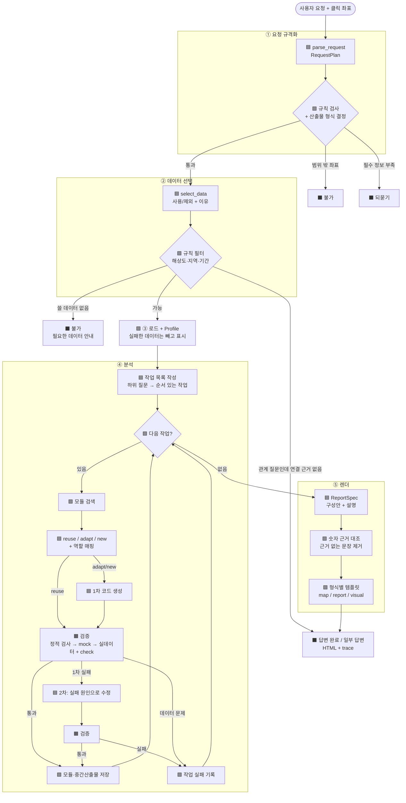

# Agent 플로우 (v0.3)

프레임워크(LangGraph 등) 없이 **Python 상태 머신 + OpenAI SDK**로 구현한다. 상태는 하나의 `RunState` 객체에 모이고, 각 단계는 `RunState`를 받아 다음 상태 이름과 갱신된 `RunState`를 돌려준다. 모든 전이는 `trace`에 기록된다.

범례: 🟦 LLM 판단 · 🟩 코드(결정적) · 🟧 생성 코드 실행(격리 프로세스) · ⬛ 종료

## 단순화 결정 이력

| 항목 | v0.1 | v0.3 |
|---|---|---|
| 분석 계획 | 작업 그래프(DAG) | **순서 있는 작업 목록**. 앞 작업의 중간산출물을 뒤 작업이 입력으로 쓸 수 있다 |
| 로드 실패 | ② 규칙 필터로 되돌아가 재판단 | **실패한 데이터만 빼고 진행**, 최종 상태 `partial` |
| 코드 검증 | 정적 검사·mock·실데이터 각각 분기 | **검증 단계 하나** (정적 검사 → mock → 실데이터 + `check()`, 첫 실패에서 중단) |
| 코드 재시도 | 최대 3회 + 3차 "다른 방법" | **최대 2회**: 1차 생성 → 2차 실패 원인으로 수정 → 그래도 실패면 작업 실패 |
| 재계획 | 실행당 최대 2회 | **삭제**. 실패한 작업은 표시하고 다음 작업으로 |
| 숫자 근거 | 1회 재생성 후 제거 | **바로 해당 문장 제거** |
| 산출물 형식 결정 | ⑤ 렌더 안 | **① 규칙 검사에서 결정** |

## 2차 수정 방법

2차는 1차와 **입력이 달라야** 의미가 있다. 실패를 코드로 먼저 분류하고, 분류별로 다른 재료를 준다.

| 분류 | 예 | 2차에서 하는 일 |
|---|---|---|
| 컬럼·역할 불일치 | `KeyError`, 역할 매핑에 없는 컬럼 | **코드가 아니라 역할 매핑을 다시** 한다 (실제 컬럼 목록을 같이 줌) |
| 형식 오류 | 날짜·숫자 변환 실패 | 1차 코드 + 해당 컬럼 샘플 값·Profile → 최소 수정 |
| 금지 사항 | 금지 import·호출 | 1차 코드 + 허용 목록 → 최소 수정 |
| 시간 초과 | 60초 초과 | 1차 코드 + "벡터 연산으로, 필요하면 기간 축소" → 수정 |
| 검증 실패 | `check()`가 문제 반환 | 1차 코드 + 실패 항목 + 출력 요약 통계 → 최소 수정 |
| **데이터 문제** | 필터 후 빈 데이터, 필요한 기간 없음 | **2차 없이 바로 작업 실패** (수정해도 소용없음) |

- 2차 코드가 1차와 같으면(공백·주석 제거 후 해시 비교) 실행하지 않고 작업 실패로 처리한다.
- `temperature=0`, `seed` 고정. 같은 입력이면 같은 결과가 재현된다.
- 작업 실패는 최종 산출물에 "무엇을 하려 했고, 왜 실패했는지"로 표시한다.

## 상한 (무한 루프 방지)

| 항목 | 상한 | 넘으면 |
|---|---|---|
| 작업별 코드 시도 | 2회 (생성 + 수정) | 작업 실패 |
| 실행 1회당 LLM 호출 | 25회 | 지금까지 결과로 렌더 |
| 생성 코드 실행 시간 | 작업당 60초 | 실패 처리 |
| 실행 1회 전체 시간 | 5분 | 지금까지 결과로 렌더 |

숫자는 초안이며 실측 후 조정한다.

## 되묻기 이후

되묻기로 끝난 실행은 `RequestPlan`을 대화 상태에 남긴다. 사용자가 답하면 새 실행이 시작되고, ①에서 이전 `RequestPlan`과 새 답을 합쳐 다시 규격화한다.

## 종료 상태

| 상태 | 언제 | 사용자에게 보이는 것 |
|---|---|---|
| `answered` | 모든 작업 성공 | HTML 산출물 |
| `partial` | 일부 작업 실패, 로드 실패, 또는 답할 수 없는 하위 질문 있음 | HTML 산출물 + 답하지 못한 부분과 이유 |
| `clarify` | 필수 정보 부족 | 질문 1개 |
| `infeasible` | 쓸 데이터 없음(도메인 밖 요청 포함: 별도 판정 없이 ②에서 걸러짐), 또는 서로 다른 두 데이터의 관계를 물었는데 의미상 연결 근거가 없음(②의 `relation`) | 이유 + 필요한 데이터 |
| `failed` | 시스템 오류(키 오류, 네트워크 등) 또는 **모든 작업 실패** | 오류 원인과 해결 방법 |
