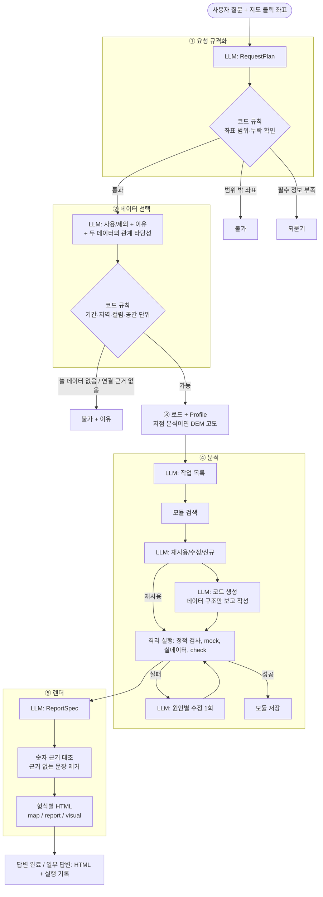

# 결과 설명자료

## 1. 문제 정의

제주의 공공데이터는 농업, 기상, 환경, 도시 등 도메인별로 흩어져 있고 형식(API, CSV, 인코딩, 단위, 시간·공간 해상도)이 제각각이다. 도민이 "제주공항 주변에서 소음이 가장 큰 곳은?", "2024년에 비가 가장 많이 온 달은?" 같은 질문에 답하려면 데이터를 찾고, 구조를 파악하고, 맞는 계산을 직접 해야 한다. 데이터 전문가가 아니면 이 과정이 큰 벽이다.

이 프로젝트의 Agent는 그 과정(데이터 탐색 → 선택 → 분석 → 결과 설명)을 대신한다. 특징은 **도메인에 묶이지 않는다는 점**이다. 데이터를 카탈로그(메타 JSON)로 등록하기만 하면, Agent가 질문에 맞는 데이터를 고르고 **그 데이터의 구조(컬럼 이름·단위·표본)만 보고 분석 코드를 직접 작성**하며, 검증한 코드는 모듈로 저장해 재사용한다. 계산 근거와 한계를 함께 보여 주고, 분석 도중의 판단은 "생각 과정"으로 사용자에게 보인다. 수익을 보장하는 서비스가 아니다.

## 2. Agent 구조

프레임워크(LangGraph 등) 없이 Python 상태 머신과 OpenAI SDK로 구현했다. 상태는 `RunState` 하나에 모이고 모든 전이가 실행 기록(`trace`)에 남는다. LLM이 하는 일(판단·생성)과 코드가 하는 일(규칙·계산·로드·상한)을 분리했다.

- **도메인 판정 게이트는 없다.** 도메인 밖 질문은 ②에서 맞는 데이터가 없어 자연스럽게 불가가 된다.
- **관계 타당성:** 서로 다른 두 데이터의 관계를 묻는 요청이면 ②에서 의미상 연결할 근거가 있는지 LLM이 판단한다(예: 주식 가격과 재배면적처럼 연결 경로가 없는 조합은 불가).
- 종료 상태: `answered`, `partial`, `clarify`, `infeasible`, `failed`.
- 상한: 실행당 LLM 호출 25회·5분, 작업당 코드 시도 2회, 코드 실행 1회 60초. 재계획은 없다.
- 구성 요소: 데이터 카탈로그와 로더, 고정 도구(날짜·숫자 변환 등), 생성 코드 실행기, 분석 모듈 라이브러리(검증된 시드 모듈 + 자동 저장·재사용), DEM 고도 조회, 지점 기후 추정, 보고서 렌더(HTML 한 파일), FastAPI, React 화면. 자세한 설계는 `docs/agent-flow.md`, `DESIGN.md`.

## 3. 주요 기능

- **여러 도메인의 데이터를 한 흐름으로 분석:** 농업(가격 통계·이동평균, 감귤 생산, 채소 재배현황), 기상(농업기상 관측소 일자료), 환경(제주공항 항공기 소음, 환경소음), 도시(도시숲 조성사업)가 같은 카탈로그에 들어 있다.
- **분석 코드 생성·검증·재사용:** LLM이 pandas 코드를 만들고 정적 검사 → 모의 데이터 → 실데이터 → `check()` 순으로 검증한다. 실패하면 원인별로 1회 수정한다. 통과한 코드는 모듈로 저장해 검색·재사용·수정한다. 검증 상태로 등록한 시드 모듈(가격 추세·변동성, 작목별 조수입, 지점 기후, 카탈로그 탐색)도 있다. 이 시드 모듈에는 아직 사람의 검토 기록이 없다.
- **데이터 탐색·선택과 근거 표시:** 어떤 데이터를 왜 쓰고 왜 뺐는지(기간·지역·공간 단위·컬럼 불일치 코드)를 표시한다.
- **생각 과정 표시:** 분석 중 요청 이해, 데이터 선택과 이유, 분석 작업 분해, 모듈 재사용·수정·신규 결정, 검증 결과를 쉬운 말로 한 줄씩 화면에 보인다.
- **지도 클릭 지점 분석:** DEM 고도 조회 + 관측소 기온의 고도 보정 보간.
- **결과 HTML:** 요약, 차트, 지도, 흐름도, 표. 계산에 근거가 없는 숫자 문장은 자동으로 지운다. 한계 문구, 출처·이용조건 자동 표시. 파일로 저장 가능.
- **실행 기록(trace):** 단계별 결정과 LLM 호출 정보(모델, 프롬프트 해시, 토큰, 시간)를 `runs/`에 저장.
- **안전 장치:** 맞는 데이터가 없으면 불가(도메인 밖 질문 포함), 제주 본섬 밖·바다 위 거절, 수익 보장 요청에는 보장 불가를 안내하고 참고 지표로 대체.

## 4. 실행 결과 (실제로 해 본 것만)

### 4.1 실제 GPT-4o 실행 (2026-11-20)

평가용 질문 57개 중 **15개를 골라 실제 GPT-4o로 돌렸다.** 질문마다 한 번씩(일부는 프롬프트를 고친 뒤 다시) 돌린 결과이고, 표는 마지막 실행 기준이다. 대표 표본이 아니라 확인하려고 고른 질문이라 **성공률로 읽으면 안 된다.** 총 비용은 약 $1이다. 실행은 `eval/run_eval.py`로 했다.

| 질문 | 종료 상태 | 평가 |
|---|---|---|
| 제주공항 소음측정소 중 소음도가 가장 높은 곳은? | 답변 완료 | 맞음. 도평동. 원자료에 `도평동`(80.2)과 `도평동591`(81.7)이 따로 있어 후자가 조금 더 높다 |
| 2024년 제주 관측소 중 연평균기온이 가장 높은 곳과 가장 낮은 곳은? | 답변 완료 | 맞음. 하례리 19.3℃, 금악리 16.3℃ (원자료로 대조) |
| 2024년 제주에서 비가 가장 많이 온 달은? | 답변 완료 | 맞음. 6월 (원자료로 대조) |
| 채소 가격 데이터는 어떤 기간까지 있어? | 답변 완료 | 맞음. 2025-12-31까지 |
| 주식 추천해줘 | 불가 | 의도대로 걸러짐 (쓸 수 있는 데이터가 없음) |
| 월동무와 깐마늘의 도매가격 변동성을 비교해줘 | 일부 답변 | 작업 3개 중 2개 성공, 비교 작업 실패 |
| 감귤 관련 데이터는 어떤 게 있어? | 일부 답변 | 작업 하나 실패 |
| (지도 클릭) 이 위치 겨울 최저기온이랑 고도는? | 일부 답변 | 작업 3개는 성공으로 표시됐으나 일부 답변인 이유는 확인하지 못함 |
| 마늘이랑 양파 중 면적당 조수입이 나은 건? | 실패 | 생성 코드의 `check()`가 문제를 반환 |
| 제주 도시숲 조성 사업량을 연도별로 보여줘 | 실패 | 코드 검증 실패 |
| 2020년 이후 서귀포시 감귤 생산 추세는? | 실패 | 컬럼 역할 매핑 오류 |
| 최근 3년간 시설채소 재배면적이 늘고 있는 작목은? | 불가 | **잘못된 불가.** 데이터가 있는데 없다고 판단 |
| 제주시 환경소음이 가장 큰 측정지점을 지도로 보여줘 | 되묻기 | 의도는 답변 완료. 위치를 되물음 |
| 제주공항 인근 항공기 소음이 2010년 이후 어떻게 변했어? | 되묻기 | 의도는 답변 완료. **수정 전 실행이고 이후 다시 돌리지 않았다** |
| 제주공항 항공기 소음과 감귤 생산량의 관계를 분석해줘 | 일부 답변 | 의도는 불가(연결 근거 없음). **수정 전 실행이고 이후 다시 돌리지 않았다.** 이 관계 판단은 아직 믿기 어렵다 |

요약: 맞는 답 4개, 올바르게 걸러진 것 1개, 일부 답변 4개, 실패 3개, 잘못된 불가 1개, 의도와 다른 되묻기 2개. 처음 실행에서는 작업 제목이 영어로 나와 검증된 모듈 검색에 실패하고, 계획과 코드의 출력 컬럼 이름이 달라 검증에서 떨어지고, 위치가 필요 없는 질문에도 위치를 되묻는 문제가 있었다. 프롬프트와 규칙을 고친 뒤 위 표의 맞는 답 4개가 나왔다. 실제 실행에서 **검증된 시드 모듈을 그대로 재사용(reuse)한 경우는 한 번도 없었고**, 대부분 새 코드 생성(new)이나 수정(revise)으로 갔다.

### 4.2 자동 테스트
- `pytest backend/tests -q`: **283개 통과**(키·네트워크 없음, LLM은 가짜, 외부 API는 가짜 서버). 테스트는 `backend/tests/synth_fixtures.py`의 테스트용 가짜 데이터를 쓰고 실데이터 스냅샷은 보지 않는다.
- 종단 간 시나리오(가짜 LLM): 지점 클릭 + 시세 질문이 `answered`로 끝나고 다섯 단계 모두 생각 과정이 남는다. 되묻기 후 이어서 분석, 도메인 밖 질문 불가, 바다 클릭 불가, 제주시 + 감귤의 `partial`을 확인했다.
- 프런트 빌드(`npm run build`, 타입 검사 포함) 통과.

### 4.3 실데이터 수집
- 허브 거래 통계 6,330행(17개 품종), 이동평균 13,158행(18개 품종), 2024-01~2025-12. 허브 명세서의 API ID로는 403이어서 허브 화면의 호출 주소의 ID를 썼다.
- 농업기상 제주 16개 관측소 5,834행(2024년). 센서 오류로 보이는 일 최저기온 -33.4℃ 한 건을 발견해 상식 범위 검사(-30~45℃)를 넣었다.
- 관측소 고도는 18~208m로 한라산 고지대가 없다는 점을 확인했다.

## 5. 검증 방법과 한계

### 검증 방법
- **자동 테스트:** 영역별 단위 테스트와 종단 간 시나리오(키 불필요).
- **코드 단계 검증:** 정적 검사, 모의 데이터 실행, 실데이터 실행, `check()`, 상식 범위, 출력 스키마.
- **숫자 근거 대조:** 보고서 문장의 숫자가 계산 결과에 있는지 검사하고 없으면 문장 삭제.
- **재현성:** `temperature=0`, 고정 seed, 샌드박스 seed 고정, 실행 기록 저장.
- **평가 도구:** 질문 57개(대표, 처음 보는 조합, 수익 보장, 범위 밖 좌표, 되묻기, 해상도 함정, 데이터 없음, 관계 타당성, 새 도메인, 실데이터 기상)와 지표·리포트 생성기(`eval/`). 이 중 15개만 실제 GPT-4o로 돌렸고 **전체 일괄 실행은 하지 않았다. 따라서 성공률·정확도 같은 정량 수치는 없다.**

### 한계 (솔직하게)
1. **실제 GPT-4o 결과가 불안정하다.** 위 4.1절대로 일부 질문은 코드 검증에서 실패하거나 일부만 답한다. 처음 보는 데이터 구조에 맞춰 코드를 한 번에 맞게 짜는 성공률은 낮다고 봐야 한다.
2. **관계 타당성 판단을 믿기 어렵다.** 연결 근거가 없는 조합(항공기 소음과 감귤 생산량)을 걸러 내지 못한 사례가 있다.
3. **시드 모듈 재사용이 실제로는 일어나지 않았다.** 검색·재사용 장치는 테스트에서 동작하지만 실제 LLM 실행에서는 확인하지 못했다.
4. **생성 코드 실행기는 보안 샌드박스가 아니다**(LLM 실수를 막는 장치). 하는 일은 정적 검사, 별도 자식 프로세스 실행과 시간 제한, 환경변수 제거로 키 차단, 네트워크·쓰기 차단 훅, 출력 검사다. 못 하는 일은 AST 이름 검사를 `getattr` 등으로 우회하는 것, 파이썬 훅 우회(`_socket`·`os.open`·ctypes), 파일 읽기와 메모리·CPU 제한이다. 신뢰할 수 없는 사용자나 외부 노출 서비스에서는 쓰지 않는다.
5. **숫자 근거 대조는 값 일치만** 본다(단위·대상이 틀려도 우연히 같으면 통과).
6. **모의 검증은 계산의 정확성을 잡지 못한다.** `check()`도 LLM이 쓴 코드다.
7. **판정하지 않는 것:** 한계온도(동해 등)로 재배 가능 여부, 재배 적합도, 수익.
8. **관측소 범위:** 기온 관측소 16개의 고도가 18~208m라 한라산 고지대는 외삽이다. DEM 90m는 고도 조회뿐이고 경사·사면·일사는 반영하지 않는다. 바다 마스크는 추정이며 마라도·추자도는 범위 밖이다.
9. **데이터 한계:** 감귤은 서귀포시뿐. 채소 재배현황은 도 전체 단위·조수입 기준(2021년 자료, 허브 가격 품종과의 이름 연결은 월동무뿐). 항공기 소음은 제주공항만, 결측 약 32%, 측정소 좌표 없음. 환경소음의 위경도는 TM 좌표를 변환한 추정(오차 약 1km). 허브 거래 데이터는 어느 시장인지 명세에 없다.
10. **지도 형식인데 좌표가 없는 결과:** 소음측정소처럼 좌표가 없는 데이터는 지도 형식으로 정해져도 점이 찍히지 않을 수 있다(답과 표는 맞다).
11. **농업기상 이용허락:** 공공누리 제4유형(변경금지)이며 가공·분석 사용은 사용자가 가능하다고 확인했다. 근거 문서나 게시판 답변은 확인하지 못했다. 다른 데이터의 이용조건도 대부분 미확인이다(`2_데이터_활용_명세.md` 4절).
12. **화면:** 이번 버전의 "생각 과정" 패널은 API 응답과 빌드까지 확인했고 브라우저 화면에서 눈으로 확인하지 못했다. 결과의 차트·흐름도 CDN 렌더링도 눈으로 확인하지 못했다. 센터 PC(i7-8700/GTX 1060/RAM 32GB)에서의 실행은 확인하지 못했다.
13. **서버 재시작 시** 진행 중 실행과 되묻기 상태가 사라진다(메모리). 한 질문에 20~60초가 걸린다.
14. 수익을 보장하지 않는다.

## 6. 센터 활용 방안

- **도메인이 늘어도 같은 입구:** 센터의 새 데이터는 카탈로그 항목(메타 JSON + CSV/API)을 추가하면 같은 흐름으로 질문·분석·보고서가 된다. 도메인별 화면이나 분석 프로그램을 따로 만들 필요가 없다. 허브에 올라오는 다양한 데이터를 도민이 질문으로 탐색하는 창구로 쓸 수 있다.
- **분석 결과의 투명성:** 사용 데이터·제외 이유·생각 과정·분석 과정·한계·출처를 결과마다 남겨 센터가 결과를 검토·감사하기 쉽다. 실행 기록(`runs/`)으로 사후 점검할 수 있다.
- **검증 모듈 축적:** 담당자가 검토한 모듈을 `modules_seed/`에 추가하면 LLM 코드 생성 없이 재사용되어 결과가 안정되고 호출 비용이 줄어든다. 실제 실행에서 재사용이 잘 안 잡힌 점은 개선 대상이다.
- **실데이터 갱신:** 센터가 허브 프로젝트 키와 공공데이터포털 키를 넣고 `collect hub`, `collect agri-weather`로 다시 수집하면 스냅샷이 갱신된다(`README.md`).
- **운영:** 센터 PC 한 대에서 단일 사용자 로컬 서비스로 동작하며 LLM은 OpenAI API를 쓴다(GPU 불필요, 센터 PC 실측은 미확인). 한 질문의 호출 비용은 약 $0.02~0.09였다. 외부 공개 서비스로 올리려면 격리 실행기를 컨테이너·OS 수준 격리로 보강해야 한다.
- **귀속:** 결과물은 제주빅데이터센터에 귀속된다(대회 규정).
