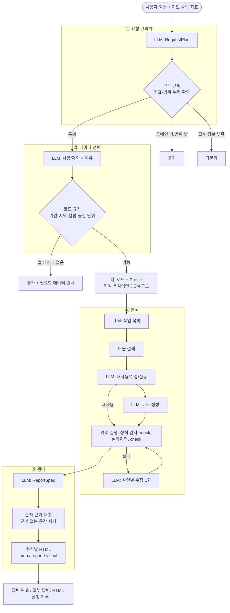

# 결과 설명자료

> 이 자료의 모든 실행 결과는 **합성 샘플 데이터 + 가짜 LLM**으로 얻은 것이다. 실제 GPT-4o와 실제 허브 거래 데이터로는 아직 실행하지 못했다. 평가 도구(티켓 13)는 아직 실행하지 못했다(키 필요). 정량 성능 수치는 없다.

## 1. 문제 정의

제주 농업 데이터는 허브·공공데이터포털 등에 흩어져 있고 형식(API, CSV, 단위, 시간·공간 해상도)이 제각각이라, 농업인·도민이 "내 땅에 뭘 심으면 좋을까", "요즘 가격이 어떤가" 같은 질문에 답하려면 데이터를 찾고 맞추고 계산하는 과정을 직접 해야 한다. 이 프로젝트는 Agent가 그 과정(데이터 탐색 → 선택 → 분석 → 결과 설명)을 대신하고, 근거와 한계를 함께 보여 주는 것을 목표로 한다. 수익을 보장하는 서비스가 아니라, 데이터에서 계산 가능한 지표(시세 추세·변동성, 지점 기후 추정, 감귤 생산 현황)를 쉽게 보여 주는 서비스다.

## 2. Agent 구조

프레임워크(LangGraph 등) 없이 Python 상태 머신과 OpenAI SDK로 구현했다. 상태는 `RunState` 하나에 모이고 모든 전이가 `trace`에 기록된다. LLM이 하는 일(판단·생성)과 코드가 하는 일(규칙·계산·로드·상한)을 분리했다.

종료 상태: `answered`, `partial`, `clarify`, `infeasible`, `failed`. 상한: 실행당 LLM 호출 25회·5분, 작업당 코드 시도 2회, 코드 실행 60초, 재계획 없음. 자세한 설계는 `docs/agent-flow.md`, `DESIGN.md`.

구성 요소: 데이터 카탈로그와 로더, 고정 도구(날짜·숫자 변환 등), 생성 코드 실행기(보안 샌드박스 아님), 분석 모듈 라이브러리(검증된 시드 모듈 + 자동 저장·재사용), DEM 고도 조회, 지점 기후 추정, 보고서 렌더(HTML 한 파일), FastAPI, React 화면.

## 3. 주요 기능

- **자연어 질문 + 지도 클릭**으로 분석 지점 지정. 위치가 필요한데 없으면 되묻고, 답하면 이어서 분석.
- **데이터 탐색·선택과 근거 표시:** 어떤 데이터를 왜 썼고 왜 뺐는지(기간·지역·공간 단위·컬럼 불일치 코드)를 화면과 결과에 표시.
- **분석 코드 생성·검증:** LLM이 pandas 코드를 만들고 정적 검사 → mock → 실데이터 순으로 검증, 실패 원인별로 1회 수정. 검증된 모듈은 재사용.
- **분석 모듈:** 시세 추세·변동성, 지점 기후 추정(DEM 고도 보정 + 관측소 보간), 작목별 면적당 조수입·재배면적 추세·순위(채소재배현황, 조수입 기준), 카탈로그 탐색.
- **결과 HTML:** 요약, 차트, 지도, 흐름도, 표. 계산에 근거가 없는 숫자 문장은 자동 삭제. 합성 데이터 경고 배너, 자동 한계 문구, 출처·이용조건 표시. 파일로 저장 가능.
- **실행 기록(trace):** 단계별 결정과 LLM 호출 정보(모델, 프롬프트 해시, 토큰, 시간)를 `runs/`에 저장.
- **데이터 모드:** 스냅샷(기본)과 라이브(허브 API + 실패 시 스냅샷 폴백).
- **안전 장치:** 도메인 밖 질문 거절, 제주 본섬 밖·바다 위 거절, 수익 보장 요청에는 보장 불가를 안내하고 참고 지표로 대체.

## 4. 실행 결과 (실제로 해 본 것만)

모두 합성 샘플 데이터와 가짜 LLM(응답을 미리 정해 둔 테스트용 어댑터)으로 확인한 것이다.

| 확인 | 방법 | 결과 |
|---|---|---|
| 전체 자동 테스트 | `pytest backend/tests -q` (티켓 17 시점, 키·네트워크 없음) | 199개 통과(티켓 16 시점 192개). 제출 직전 재실행 필요 |
| 대표 질문 종단 간 | `backend/tests/e2e` 시나리오: 지도 클릭 + "여기에 월동무 어때? 최근 시세도 같이 알려줘" | `answered`. 지점 지도, 고도, 교차검증, 시세 차트, 최상단 합성 경고 배너, 한계 문구가 결과에 포함. 코드 생성 LLM 호출 0회(검증된 모듈 재사용) |
| 되묻기 | 위치 없이 지점 질문 → 되묻기 → 지도 클릭 후 답 | 이어서 분석 완료 |
| 작목 비교 | `backend/tests/e2e/test_crop_economics.py`(가짜 LLM): "뭘 늘리면 좋을까?", "마늘이랑 양파 중 면적당 조수입이 나은 건?" | 재배현황 선택, 검증된 모듈 재사용, 한계 문구 포함 HTML, 지도 없음 |
| 불가 처리 | 도메인 밖 질문, 바다 클릭 | `infeasible` |
| 제주시 + 감귤 | 서귀포 데이터만 있는 경우 | 서귀포 데이터 제외 안내 + `partial` |
| 브라우저 확인 | 데모 서버(가짜 LLM) + `npm run dev`로 지도 클릭, 합성 배너, 지표 표 | 확인(티켓 16). 차트(Chart.js)·흐름도(Mermaid)의 CDN 렌더링은 눈으로 확인하지 못함 |
| 프런트 빌드 | `npm run build` | 통과 |

제출 문서 작성 중에 한 재현 확인(압축 해제 → 새 환경 설치 → 테스트·빌드)은 이 문서 하단 7절과 티켓 14의 `## Result`에 기록했다.

수치 결과의 예: 합성 데이터에서 지점 기온 추정 교차검증은 일 MAE 0.50 대 최근접 1.35이다. **진값(감률 6.5℃/km)으로 합성한 데이터라서 나온 숫자이며 실제 성능이 아니다.**

## 5. 검증 방법과 한계

### 검증 방법
- **자동 테스트(키 불필요):** 영역별 단위 테스트와 종단 간 시나리오. LLM은 가짜 어댑터, 외부 호출은 가짜 서버(MockTransport)로 대체.
- **코드 단계 검증:** 정적 검사, mock 데이터 실행, 실데이터 실행, `check()`, 상식 범위, 출력 스키마.
- **숫자 근거 대조:** 보고서 문장의 숫자가 계산 결과(셀 값, 통계, 변화량 등)에 있는지 검사하고 없으면 문장 삭제.
- **재현성:** `temperature=0`, 고정 seed, 샌드박스 seed 고정, 실행 기록 저장.
- **평가 도구(티켓 13):** 질문 세트 + 실제 GPT-4o 일괄 실행 + 리포트 계획. **아직 실행하지 못했다(키 필요). 따라서 성공률·정확도 같은 수치는 없다.**

### 한계 (솔직하게)
1. **합성 데이터:** 거래·기온은 합성이다. 허브 거래 데이터 실수집은 키가 필요하고 실호출·응답 형식·오류 형식은 확인하지 못했다.
2. **실제 GPT-4o 미검증:** 프롬프트, Structured Outputs 스키마 호환, 코드 생성 성공률, 모듈 재사용 결정은 가짜 LLM 기준이다. 실제 모델이 계획에 가상 입력을 넣지 않으면 재사용 모듈이 안 잡혀 코드 생성으로 갈 수 있다.
3. **생성 코드 실행기는 보안 샌드박스가 아니다**(LLM 실수 방지 장치). 우회 가능성이 있어 외부 노출 금지.
4. **판정하지 않는 것:** 한계온도(동해 등)로 재배 가능 여부, 재배 적합도, 수익. 극최저기온·저온 일수는 참고 지표로만 표시.
5. **DEM 90m:** 고도 조회뿐이며 경사·사면·일사는 반영하지 않는다. 바다 마스크는 추정이라 해안 점은 신뢰하지 말 것. 마라도·추자도는 범위 밖.
6. **감귤:** 서귀포시 데이터뿐이고 제주시는 없다.
7. **채소재배현황:** 도 전체 단위(지점 차이 설명 불가), 조수입 기준(비용 없음, 순이익 아님), 연산 최신 20-21·기준일 2021-08-09. 카탈로그 `jeju_vegetable_cultivation`과 모듈 `market-crop-economics`로 반영되어 있고 한계 문구가 결과에 자동으로 들어간다(`data-spec.md` 6절). 허브 가격 품종과의 이름 연결은 월동무 하나뿐이다.
8. **농업기상 관측데이터:** 공공누리 제4유형(변경금지)이라 가공·분석 결과 사용 가능 여부를 게시판에 문의할 예정이며 현재는 사용하지 않는다.
9. **숫자 근거 대조는 값 일치만** 본다(단위·대상이 틀려도 우연히 같으면 통과).
10. **mock 검증은 계산의 정확성을 잡지 못한다.** `check()`도 LLM이 쓴 코드다.
11. **화면:** 결과의 차트·흐름도 CDN 렌더링을 실제 브라우저에서 눈으로 확인하지 못했다. 센터 PC(i7-8700/GTX 1060/RAM 32GB)에서의 실행은 확인하지 못했다.
12. **서버 재시작 시** 진행 중 실행·되묻기 상태가 사라진다(메모리).
13. 수익을 보장하지 않는다.

## 6. 센터 활용 방안

- **데이터 탐색·시각화 창구:** 데이터 카탈로그에 항목(메타 JSON + CSV/API)을 추가하면 같은 흐름으로 질문·분석·보고서가 가능하다. 센터의 새 데이터를 도민이 질문으로 탐색하는 입구로 쓸 수 있다.
- **분석 결과의 투명성:** 사용 데이터·제외 이유·분석 과정·한계·출처를 결과마다 남기므로 센터가 결과를 검토·감사하기 쉽다. 실행 기록(`runs/`)으로 사후 점검 가능.
- **검증 모듈 축적:** 담당자가 검토한 모듈을 `modules_seed/`에 추가하면 LLM 코드 생성 없이 재사용되어 결과가 안정되고 호출 비용이 줄어든다.
- **실데이터 전환:** 센터가 허브 프로젝트 키를 넣고 `JEJU_DATA_MODE=live`로 수집하면 합성 샘플 대신 실데이터가 우선된다(`README.md`). 전환 후 결과 검증(실제 GPT-4o 종단 간 실행, 평가 도구 실행)이 필요하다.
- **운영:** 센터 PC 한 대에서 단일 사용자 로컬 서비스로 동작하며 LLM은 OpenAI API를 쓴다(GPU 불필요, 센터 PC에서의 실측은 미확인). 외부 공개 서비스로 올리려면 격리 실행기를 컨테이너·OS 수준 격리로 보강해야 한다.
- **귀속:** 결과물은 제주빅데이터센터에 귀속된다(대회 규정).

## 7. 깨끗한 환경 재현 기록

(티켓 14 `## Result`에 상세 기록. 요약은 아래.)

제출 zip을 `scripts/make_submission.py`로 만들어(159개 파일, 약 2MB, 비밀값 점검 통과) 임시 폴더에 풀고, README 절차대로 확인했다.

| 단계 | 결과 |
|---|---|
| 새 venv(Python 3.14.8) + `pip install -r backend/requirements.txt` | 성공 |
| `pytest backend/tests/runner backend/tests/catalog backend/tests/e2e -q` | 31개 통과 (e2e에 지점 클릭 + 월동무 대표 질문 시나리오 포함, 가짜 LLM) |
| `import jejuagent.api.main` | 성공(FastAPI 앱 생성) |
| 프런트 `npm ci` + `npm run build` | 성공 |

확인하지 못한 것: 전체 테스트 199개의 압축 해제본 재실행, 실제 GPT-4o 실행, 실데이터 수집, 센터 PC 사양에서의 실행.
